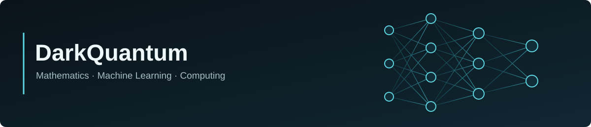

  

### Hi, I'm Carlos.

I studied **Applied and Computational Mathematics at UNICAMP**. My main interests are **machine learning, mathematical optimization, and scientific computing**.

I use this GitHub to share implementations, experiments, and projects in these areas.

### Selected projects

- **[Quaternion Neural Cellular Automata](https://github.com/DarkQuantum-bit/Quaternion-Neural-Cellular-Automata)** — experiments with hypercomplex neural cellular automata.
- **[Neuro-Fuzzy Systems](https://github.com/DarkQuantum-bit/MS580_Neuro-Fuzzy)** — adaptive neuro-fuzzy inference systems (ANFIS).
- **[Integer Programming](https://github.com/DarkQuantum-bit/programacao-inteira)** — project portfolio optimization.
- **[Network Flows](https://github.com/DarkQuantum-bit/fluxos_em_redes)** — graph algorithms and network-flow optimization.

### Tools

`Python` · `NumPy` · `pandas` · `scikit-learn` · `PyTorch` · `SQL` · `Git`
