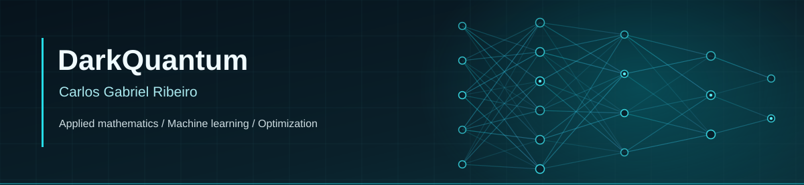
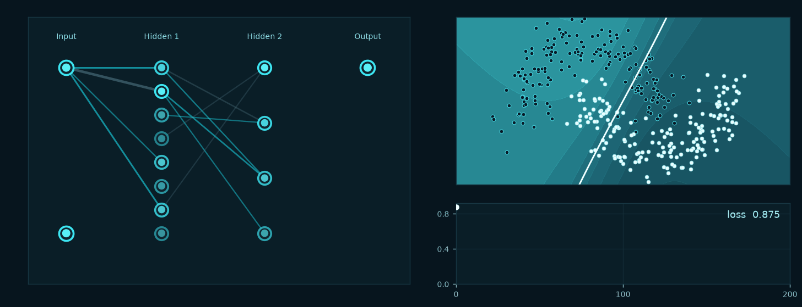

  

### Hi, I'm Carlos.

I graduated in **Applied and Computational Mathematics at UNICAMP**. I'm interested in machine learning, mathematical optimization, and scientific computing.

I use this space to share implementations, experiments, and projects.

### Selected work

- **[Quaternion Neural Cellular Automata](https://github.com/DarkQuantum-bit/Quaternion-Neural-Cellular-Automata)** — hypercomplex neural cellular automata.
- **[Neuro-Fuzzy Systems](https://github.com/DarkQuantum-bit/MS580_Neuro-Fuzzy)** — experiments with adaptive neuro-fuzzy inference systems (ANFIS).
- **[Integer Programming](https://github.com/DarkQuantum-bit/programacao-inteira)** — project portfolio optimization.
- **[Network Flows](https://github.com/DarkQuantum-bit/fluxos_em_redes)** — network-flow models and algorithms.

### Tools & interests

**Languages:** `Python` · `SQL` · `Julia`  
**Data & AI:** `Data Analysis` · `Machine Learning` · `Deep Learning`  
**Mathematics:** `Optimization` · `Scientific Computing`

### Learning dynamics

A small neural network learning a nonlinear decision boundary, from a fixed synthetic dataset. The animation is generated from [reproducible Python code](./scripts/train_visualization.py) through [GitHub Actions](./.github/workflows/ml-visualization.yml).

  

